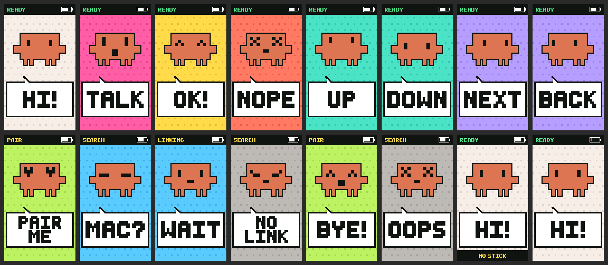

# vibe-stick

A talk button for vibe coding — drive Claude Code in VS Code by voice, hands off the keyboard. *(한국어: [README.ko.md](README.ko.md))*

An M5StickC Plus with the Mini JoyC HAT, turned into a **Bluetooth keyboard**. Speech recognition is the dictation built into the Claude Code VS Code extension (⌘D). **Nothing to install on the computer.**


*All screens, pixel-identical to the device. Default mascot = unofficial Claude Code fan art, not covered by MIT — see [Mascot](#mascot).*

## ⚠️ Read first — risks

**Build the firmware yourself from this repository (https://github.com/parkds-claude/vibe-stick-public) and never flash a binary from anywhere else** — a modified build is a keyboard that types whatever its author wants. There are no releases or prebuilt firmware. Security notes and how to report a problem: [SECURITY.md](SECURITY.md).

This device **is a keyboard**. It sends Enter, Esc and ⌘D to the paired computer, and Enter **approves** Claude's "may I edit this file?" prompt.

- **Pairing has no numeric confirmation (Just Works).** While the screen shows PAIR ME, any nearby computer can try to pair, and **the first one wins**: the device then belongs to that computer until you reset it (front + side for 3 s). An eavesdropper present at pairing time could in principle derive the link key (what it would see: Enter, Esc, ⌘D, arrows). Pair at home or at your desk; afterwards the device accepts only that one computer (one bond at a time).
- **If you lose the device**, whoever finds it can press Enter near the paired computer, and **anyone holding it can reset the pairing** (no PIN). If it goes missing, **remove `vibe-stick` from the computer's Bluetooth settings immediately.**
- The device cannot see the computer's screen. **Look at the screen before pressing the front button.** With an editor focused, the front button and joystick keystrokes go **into the file**. Pressing the side button (Esc) twice quickly opens Claude Code's *Rewind* dialog — Enter there **reverts files**; the device limits Esc to once per second, but if you see "Rewind", close it with the side button. More cautions (Korean): [docs/사용법.md](docs/사용법.md) "조심할 것 세 가지".
- The Bluetooth name `vibe-stick` and the fact that it is a keyboard are always advertised.

## Two builds

| | StickC build (`src/`) | CoreS3 build (`cores3/`) |
|---|---|---|
| Hardware | M5StickC Plus + Mini JoyC HAT | M5Stack CoreS3 (touch screen) |
| Connection | Bluetooth keyboard | **USB keyboard + USB microphone** on one cable; Bluetooth keyboard when unplugged |
| You speak into | the computer's microphone | the device's microphone over USB — once you select it as the computer's sound input |
| Controls | joystick + two buttons | seven touch tiles |
| Toolchain | PlatformIO | ESP-IDF 5.5 |
| Guide | [docs/사용법.md](docs/사용법.md) | [docs/사용법-cores3.md](docs/사용법-cores3.md) |


*CoreS3 build: every screen, pixel-identical to the device. The icons are plain line art drawn by the build script. The mascot is the same unofficial Claude Code fan art as above (not covered by MIT — see [Mascot](#mascot)); to build with one of the original mascots instead: `cd cores3 && idf.py -B build -DMASCOT=Cat reconfigure`, then `tools/flash.sh`.*

Both builds are keyboards. **Read [SECURITY.md](SECURITY.md) before flashing either one**, build the firmware yourself, and never flash a binary someone else made.

## The CoreS3 build at a glance — a remote control for Claude Code (unofficial)

- **A remote control for Claude Code.** Press, then tell it what to do by voice — no keyboard. Unplug the cable and it carries on over Bluetooth (then only the button presses are sent).
- **Press, then say it.** With the cursor in Claude Code's input box, what you say is transcribed by Claude Code in VS Code. Press OK and it is sent as is.
- **"May I edit this?" — answer with your thumb.** Read the prompt on the Mac's screen: OK to allow, ✕ if not. No reaching for the keyboard.
- **Unplugged, and pressed from a distance.** The author tried it from 20 m away and the button presses still got through. The prompt is not shown on the device, though — look at the Mac's screen before you press. (Range varies with the surroundings.)
- **Plug it in and the device is the microphone.** Pick `vibe-stick mic` as the Mac's sound input and you speak into the device — even on a Mac with no microphone. Over Bluetooth, the listening is done on the Mac's side — its own microphone or your earphones.
- **Meet the little square: an M5Stack CoreS3.** A 54 mm square with a 2-inch touch screen; microphone and speaker built in. The 500 mAh battery sits in the base on the back — the DinBase the CoreS3 ships with has one, and the author's unit has the thinner M5GO Battery Bottom3 (also 500 mAh) there instead. (Not tried on the CoreS3 SE, which has no battery.)
- **Seven places to press on the screen.** Four large tiles — Talk · OK · Back · Next — and three small ones above them: ▲ · ▼ · ✕ (up, down, cancel).
- **And this remote is open source** (MIT, except the default mascot — see [Mascot](#mascot)). No soldering: build the firmware yourself from this source and flash it (no prebuilt firmware is published). How to build it: [docs/사용법-cores3.md](docs/사용법-cores3.md) (Korean).

*An unofficial hobby project, not affiliated with Anthropic — see [Unofficial](#unofficial). The sections from "Controls" through "Development" below describe the StickC build.*

## Controls

| Control | Action | Screen |
|---|---|---|
| Joystick **press** | Toggle dictation (⌘D) — one click | TALK |
| **Front button** | Enter — send · allow · confirm | OK! |
| **Side button** | Esc — cancel · deny (max once per second) | NOPE |
| Joystick **right / left** | ⌘` / ⇧⌘` — next / previous VS Code window | NEXT / BACK |
| Joystick **up / down** | ↑ ↓ — move between choices | UP / DOWN |
| Front + side for **3 s** | Forget the pairing and restart | BYE! |

Usage, pairing and troubleshooting (Korean): [docs/사용법.md](docs/사용법.md)

## Assumptions and limitations

- **macOS + VS Code + the Claude Code extension's default shortcuts only.** It sends ⌘D (dictation) and ⌘` (next window of the same app). If you remapped those, it will not match. Windows gets Ctrl+D only, no window switching (`HOST` in `src/config.h`). No Linux yet.
- **The device does not know whether recording is on.** TALK is a guess from how many ⌘D it sent. If the computer stops recording by itself after 15 s of silence, or ⌘D does something else in another window, the screen and reality diverge. **The microphone indicator on the computer is the truth.**
- Misrecognized text cannot be deleted from the device (use the keyboard, or ask Claude to fix it).
- The battery is small (120 mAh). The screen dims after 30 s; there is no deep sleep yet (runtime not measured). Keep it on USB at a desk.
- The joystick's I²C data line shares the ESP32 boot-strap pin (G0). **Do not reset the board from a serial tool with the joystick attached** — it drops into download mode and looks frozen (see `tools/unstick.py`, or unplug the joystick and power-cycle).

## Parts and flashing

| Part | Official name · SKU | Docs | Buy (M5Stack store, checked 2026-10) |
|---|---|---|---|
| Body | **M5StickC PLUS** (ESP32-PICO-D4, 4 MB flash, 1.14" LCD, 120 mAh) · K016-P | [docs](https://docs.m5stack.com/en/core/m5stickc_plus) | [$19.95 — EOL, remaining stock](https://shop.m5stack.com/products/m5stickc-plus-esp32-pico-mini-iot-development-kit) |
| Joystick | **M5StickC Mini JoyC HAT** (STM32F030, I²C 0x54, one joystick + click + RGB LED) · U156 | [docs](https://docs.m5stack.com/en/products/sku/U156) | [$8.50](https://shop.m5stack.com/products/m5stickc-mini-joyc-hat-stm32f030) |
| Cable | USB-C (data-capable) | | |

- Built and verified on the **original M5StickC PLUS**. The successor **PLUS2** (ESP32-PICO-V3-02, 8 MB, K016-P2) is also EOL/out of stock and **untested with this firmware** (different power-management chip; `M5Unified` may accept it but no promises). The newer **M5StickS3** uses a different chip (ESP32-S3) and will not work as is. Second-hand, local distributors and AliExpress still list "M5StickC Plus".
- The joystick must be the **Mini** JoyC (U156), not the two-stick "JoyC HAT" (U079, I²C 0x38).
- [PlatformIO](https://platformio.org/) (VS Code extension or `pip install platformio`). Libraries are fetched at build time.

```
pio run -e stickc                                   # build
pio run -e stickc -t upload --upload-port <PORT>    # flash (<PORT> = /dev/cu.usbserial-… or COMx)
pio run -e stickc-debug -t upload --upload-port <PORT>   # build with diagnostic logging
```

After flashing: the screen shows **PAIR ME** → macOS System Settings → Bluetooth → connect `vibe-stick` → **HI!** means done. It reconnects by itself from then on.

## Structure

`src/logic/` is pure, hardware-free code tested on the host. The thin hardware layer (`src/*.cpp`) is verified on the device, not by tests.

| File | Role |
|---|---|
| `src/logic/joy_filter.*` | Joystick reads: bridge short failures, debounce the click, axis orientation |
| `src/logic/input_logic.*` | Buttons + joystick → events (talk mode, direction decisions, cancel cooldown) |
| `src/logic/keymap.*` | Events → keys |
| `src/logic/dispatch.*` | Event handling: key ordering, drop when disconnected, release keys on link change |
| `src/logic/link_tracker.h` | BLE events (connect / encrypt / drop) → link state |
| `src/logic/scene.h`, `pixel_art.*`, `screen_draw.*` | Screen: scenes, bitmap font and mascots, drawing with fill-rect only |
| `src/logic/screen_state.h` | Which scene to show now |
| `src/logic/debounce.h`, `clock.h`, `link_state.h` | Helpers: debouncing, wrap-safe time compare, link states |
| `src/ble_hid.*` | Bluetooth keyboard (NimBLE) |
| `src/joyc.*` | Joystick over I²C |
| `src/ui.*` | LCD output, brightness |
| `src/config.h` | Settings (host OS, talk mode, joystick orientation) |

Design decisions are recorded in code comments as `D<number>` with reason, cost and how to revert.

## Development

```
test/host/run.sh                 # host tests: input+link / screen / loop-order integration (no device needed)
test/host/preview.sh             # render every screen → docs/design/screens.png (overwrites it; pixel-identical to the device)
test/host/compare_refactor.sh    # fuzz-compare behaviour before/after a refactor
```

122 test scenarios (80 input/link, 37 screen, 5 loop integration) with ~8,000 CHECKs inside loops.

Serial log without resetting the board (never use `--reset` with the joystick attached):

```
~/.platformio/penv/bin/python tools/serial_capture.py <PORT> 20     # any python with pyserial works
```

## Mascot

The default mascot is an **unofficial pixel-art rendition of the Claude Code character**, made by the author for personal use. **It is not covered by the MIT license** — rights remain with Anthropic, it is not endorsed by them, and it will be removed on request (it also stays in this repository's git history until then). **Do not use it commercially or in hardware you sell or distribute**; build with `-DMASCOT_ID=Cat` or another original mascot instead. Five original mascots (MIT) are included and selectable at build time.

| Name | Build value | Look |
|---|---|---|
| Claude (default) | `Claude` | unofficial fan art |
| Cat | `Cat` | black cat |
| Stick | `Stick` | arcade joystick |
| Keycap | `Keycap` | a key that escaped the keyboard |
| Robot | `Robot` | robot with an antenna |
| Sprout | `Sprout` | mochi with a sprout |

Change `MASCOT_ID` in `src/logic/pixel_art.h` or pass `PLATFORMIO_BUILD_FLAGS="-DMASCOT_ID=Cat" pio run …`. Preview first with `test/host/preview.sh`. Mascot data is a character grid in `src/logic/pixel_art.cpp`, so drawing your own is easy. All five: [docs/design/mascots.png](docs/design/mascots.png)

## Unofficial

An independent hobby project, not affiliated with, endorsed by or sponsored by Anthropic (Claude, Claude Code), M5Stack, Apple or Microsoft (VS Code). Trademarks belong to their owners. Third-party notices and the mascot exception: [NOTICE](NOTICE). License for the code and the five original mascots: [MIT](LICENSE).
