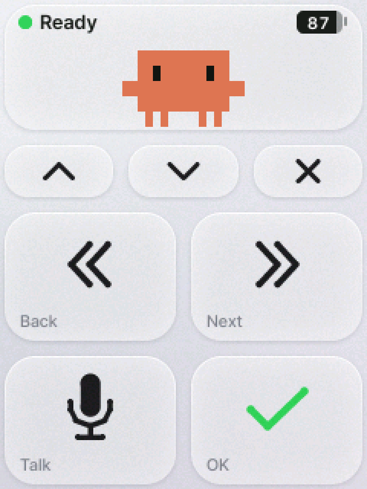

# vibe-stick CoreS3 판 사용법

M5Stack CoreS3 를 **화면을 눌러 Claude Code 에 말로 지시하는 기기**로 만든다. USB 선 하나로 맥에 "키보드 + 마이크"로 잡히고, 선을 뽑으면 버튼만 블루투스 키보드로 간다. 음성 인식은 Claude Code 의 받아쓰기(⌘D)를 그대로 쓴다.

왼손에 세로로 쥐고 엄지로 누른다. USB 선은 위로 빠진다. 모든 장면은 [design/cores3-screens.png](design/cores3-screens.png).

## 필요한 것

- M5Stack CoreS3 와 데이터가 되는 USB-C 선
- macOS — 굽는 도구가 macOS 용이고, 키는 맥의 단축키(⌘D · ⌘`)로 나간다
- VS Code + Claude Code 확장(음성 받아쓰기 ⌘D 가 되는 상태)
- ESP-IDF 5.5.x (v5.5.4 로 만들고 확인했다)

## 빌드하고 올리기

**1. ESP-IDF 를 준비한다.** `tools/flash.sh` 는 `~/esp/esp-idf-5.5.4` 를 찾는다(다른 곳에 깔았으면 스크립트의 그 줄을 고친다). 처음이면 [Espressif 안내](https://docs.espressif.com/projects/esp-idf/en/stable/esp32s3/get-started/)의 준비물을 깐 뒤:

    mkdir -p ~/esp && cd ~/esp
    git clone -b v5.5.4 --recursive https://github.com/espressif/esp-idf.git esp-idf-5.5.4
    git -C esp-idf-5.5.4 rev-parse HEAD      # 735507283d5b2f9fb363a1901172dbd9e847945d 이어야 한다(v5.5.4)
    ~/esp/esp-idf-5.5.4/install.sh esp32s3

**2. 내 기기의 MAC 을 적어 둔다.** 도구는 `cores3/.vibe-mac` 에 적힌 MAC 의 기기에만 굽고, 백업하고, 되돌린다(없으면 굽지 않는다). 내려받기 모드의 ESP32-S3 보드는 USB 에서 모두 같게 보여, 적어 두지 않으면 옆에 꽂힌 다른 보드를 덮어쓸 수 있다.

    cd <저장소>/cores3 && source ~/esp/esp-idf-5.5.4/export.sh
    # 기기의 RST 버튼을 3초 누른다(초록 불 = 내려받기 모드)
    python tools/backup.py ~/cores3-original.bin   # 처음에는 멈추고 이 보드의 MAC 을 알려 준다
    echo <MAC 12자리> > .vibe-mac                    # 다른 ESP32 보드는 뽑아 두고, 내 기기가 맞을 때만

**3. 올리기 전에 원래 내용을 백업한다.** 같은 명령을 다시 돌리면 플래시 16MB 를 통째로 받는다.

    python tools/backup.py ~/cores3-original.bin
    python tools/backup.py --verify ~/cores3-original.bin    # 기기의 내용과 같은가

- 받다가 끊기면 RST 3초 뒤 `--resume`, 원래대로 되돌릴 때는 RST 3초 뒤 `--restore`(파일의 지문을 보여 주고 `restore` 라고 쳐야 쓴다 — **내가 이 기기에서 받은 파일만** 되돌려 쓴다. 남이 준 파일은 굽지 않는다).
- 백업에는 예전 펌웨어의 와이파이 비밀번호 같은 것까지 담긴다. 저장소 밖에 두고 남에게 주지 않는다.
- UIFlow2 가 도는 기기에는 `esptool` 을 직접 쓰지 않는다(USB 에서 사라진다. RST 를 짧게 누르면 돌아온다).

**4. 올린다.** 처음에는 내려받기 모드(초록 불)에서 실행한다. 빌드해서 굽고, 올라간 것이 평소 판(`dev=0`)인지 기기에게 확인한다.

    tools/flash.sh

**다음부터는** RST 가 필요 없다. 실행하면 화면에 **`Update firmware? Hold OK`** 가 뜬다. 손을 뗀 채 2초쯤 기다렸다가 **✓(OK 타일)를 2초쯤 꾹 눌렀다 뗀다**(1.5초를 넘겨야 하고, 뜬 뒤 20초 안에). 톡 친 ✓, 다른 자리와 함께 눌린 ✓, 뜨기 전부터 닿아 있던 손가락은 받지 않는다. ✕ 나 시간 초과로 취소되면 10초쯤 뒤 다시 실행한다. 반응이 없으면 **RST 3초**(초록 불) 뒤 다시 실행한다.

**개발판**(`tools/flash.sh --dev`)은 펌웨어를 고치며 시험할 때만 쓴다. 컴퓨터의 아무 프로그램이나 이 기기에게 키를 치게 할 수 있고, 화면에 묻지 않고 다시 구워지며, 명령이 3분 없으면 스스로 내려받기 모드로 물러난다. 시험이 끝나면 평소 판을 다시 올린다. **개발판은 평소 화면 맨 위에 자홍·검정 띠가 보인다** — 그 띠가 보이는 기기는 쓰지 않는다(잊어버린 개발판을 알아채라는 표시다). `python tools/vibectl.py cmd status` 의 `dev=0`(평소) · `dev=1`(개발)로도 알 수 있다.

## 처음 한 번 (맥에서)

1. **맥의 잠금을 푼 채** USB 로 꽂는다. "액세서리 연결을 허용하겠습니까?" 가 뜨면 **허용**. 맨 위에 초록 점과 `Ready` 가 뜬다.
2. "키보드 설정 도우미" 창이 뜨면 닫는다.
3. **설정 > 사운드 > 입력에서 `vibe-stick mic` 을 고른다.** 골라야 기기 마이크로 말이 들어간다.
   - 고르지 않아도 받아쓰기는 맥의 다른 마이크로 된다. 그때 기기의 빨간 표시는 **빈 고리**(어림)다.
   - 고른 동안에는 맥의 다른 프로그램(화상 회의 등)도 이 마이크로 듣는다.
   - 받아쓰기가 말을 놓치면 같은 창의 입력 음량을 올린다.
4. **VS Code 에 단축키 두 줄**을 넣는다(Back·Next 를 짧게 눌러 옆 패널로 가려면). `⇧⌘P` → "Preferences: Open Keyboard Shortcuts (JSON)":

       { "key": "f17", "command": "workbench.action.focusPreviousGroup" },
       { "key": "f18", "command": "workbench.action.focusNextGroup" }

## 타일

| 누르는 곳 | 보내는 키 | Claude 에서 |
|---|---|---|
| **Talk**(왼쪽 아래) | ⌘D | 말하기. 한 번 누르면 듣기 시작, 다시 누르면 끝 |
| **OK**(오른쪽 아래, ✓) | Enter | 보내기 · 허락 · 선택 확정 |
| **Back · Next** 짧게 | F17 · F18 | 같은 VS Code 창의 옆 패널로(위 단축키) |
| **Back · Next** 길게(0.6초) | ⇧⌘` · ⌘` | 같은 앱의 다른 창으로 |
| **▲ ▼** | ↑ ↓ | 선택지 옮기기. 누르고 있으면 계속 간다 |
| **✕** | Esc | 취소 · 거부 · 작업 중단. 1초에 한 번만 |
| **OK + ✕** 3초 | — | 블루투스 짝 지우기 |
| 맨 위 칸(캐릭터) 톡 | — | 빨간 "듣는 중" 표시만 뒤집는다(아래) |

누르는 순간 타일이 어두워진다. 어두워지지 않았으면 눌리지 않은 것이다. OK 와 ✕ 는 뗄 때 나가고, Talk 를 누르고 있는 동안에는 듣지 않는다.

### 버튼이 일부러 듣지 않는 때

Enter 한 번이 Claude 의 허락을 승인할 수 있어서, "지금 화면을 보고 누른 것"이 아닌 누름은 받지 않는다.

- **켠 뒤 3초**, 그리고 손을 떼고 1초 쉴 때까지.
- **연결이 막 됐거나 길(선 ↔ 블루투스)이 바뀐 직후 0.5초.**
- **꺼진 화면을 누른 그 한 번** — 화면만 켜진다. 손을 뗀 뒤 다시 누른다. (어두워지기만 한 화면에서는 그대로 동작한다.)
- **`Update firmware? Hold OK` 가 떠 있는 동안과 사라진 직후 0.7초**(✓·✕ 만 답으로 받는다).

### 말로 지시하기

1. 커서가 Claude 입력창에 있는지 본다. 편집기에 있으면 ⌘D 와 Enter 가 파일로 들어간다.
2. **Talk** 를 누른다. 곧바로 맨 위 칸과 Talk 타일이 빨갛게 바뀐다(`Listening`).
3. 말한다. 캐릭터의 입과 옆의 막대가 움직인다 — 움직이지 않으면 목소리가 작거나 멀다.
4. **OK** 를 누른다. 듣기가 끝나고 그대로 보내진다. 글을 먼저 보고 싶으면 Talk 로 끝낸 뒤 OK.

빈 입력창에서 ▲ 뒤 OK 는 직전 지시를 다시 보낸다. ✕ 는 진행 중인 작업을 멈춘다.

## 화면이 알려 주는 것

맨 윗줄 왼쪽이 연결 상태, 오른쪽이 배터리(숫자 = 남은 %, 충전 중 초록, 20% 이하 빨강)다.

| 화면 | 뜻 | 할 일 |
|---|---|---|
| 초록 점 `Ready` / 파란 점 `Bluetooth` | 선으로 / 블루투스로(버튼만) 준비됨 | — |
| 빨간 칸 + **채운 흰 점** `Listening` | **사실** — 맥이 이 기기의 마이크를 열었다 | 말한다. 누르지 않았는데 이렇다면 다른 프로그램이 이 마이크를 열어 둔 것이다 |
| 빨간 칸 + **빈 고리** `Listening` | **어림** — Talk 를 눌렀지만 맥은 이 마이크를 열지 않았다(소리 입력이 다른 마이크이거나 블루투스) | 받아쓰기는 맥의 다른 마이크로 된다 |
| 빨간 빈 고리 `Not connected` · `No computer found` | 쓸 컴퓨터가 없다(선도 블루투스도 없음, 또는 맥이 잠듦) | 선을 꽂거나 맥 가까이로 |
| 노란 반원 `Waiting` · `Allow on your Mac` | 맥이 기기를 알아봤지만 쓰지 않는다 | 잠금을 풀고 "허용" |
| 노란 반원 `Pairing` · `Pair in Bluetooth settings` | 선도 없고 짝을 맺은 컴퓨터도 없다 | 아래 "선 없이 쓰기" |
| 슬픈 얼굴 `Key not sent`(1.5초) | 방금 누른 키가 나가지 않았다 | 맨 윗줄을 본다. 이어지면 선을 다시 꽂는다 |
| `Pairing cleared` / `Pairing not cleared` | 짝을 지웠다(곧 재시작) / 지우지 못했다 | 못 지웠으면 한 번 더, 이어지면 껐다 켠다 |
| `Update firmware? Hold OK`(✓·✕ 만 켜짐) | 컴퓨터가 펌웨어를 바꾸려 한다 | 내가 올리는 중이면 ✓ 를 꾹, 아니면 ✕ |

빈 고리의 빨강은 Talk 를 다시 누르거나, OK 를 누르거나, 15초쯤 말소리가 없으면 꺼진다(길어도 2분).

### 빨간 표시가 실제와 반대일 때 (빈 고리일 때만)

맥의 받아쓰기는 조용하면 스스로 꺼지고, 기기는 그것을 제 마이크로 어림한다. 둘이 어긋나면 그 뒤로는 Talk 를 누를 때마다 화면과 실제가 반대로 간다.

- **맨 위 칸(캐릭터)을 손가락 하나로 짧게(0.7초 안) 톡 친다.** 빨간 표시만 켜지거나 꺼지고, 키는 나가지 않는다. 맥 화면의 받아쓰기 표시와 같게 맞춘다. 15초쯤 그냥 두어도 다시 맞는다.
- 듣지 않는 때: 화면이 어둡거나 꺼져 있을 때와 켜진 직후 0.5초(화면만 켜진다) · 알림이 떠 있을 때(첫 톡은 알림만 거둔다) · 채운 점일 때(사실이라 틀릴 수 없다) · 위 "버튼이 일부러 듣지 않는 때".
- 선으로 쓰고 소리 입력이 `vibe-stick mic` 이면 어긋나지 않는다(채운 점 — 사실만 보인다). 그때는 Talk 를 한 번 누른 뒤로 톡이 빨강을 켜지 않는다.

## 선 없이 쓰기 (블루투스 — 버튼만)

선을 뽑으면 버튼은 블루투스로 간다. 기기 마이크의 소리는 선으로만 간다 — 무선일 때 말은 맥의 마이크나 이어폰으로 한다.

1. 처음 한 번: 맥의 설정 > 블루투스에서 **`vibe-stick S3`** 를 연결한다(기기는 선이 꽂혀 있어도 늘 자기를 알린다).
2. 선을 뽑는다. 파란 점 `Bluetooth` 가 뜨면 된다. 다시 꽂으면 `Ready` 로 돌아온다.
3. **짝 지우기**: OK 와 ✕ 를 3초 함께 누른다(`Pairing cleared` → 재시작). 한 번에 한 컴퓨터와만 짝을 맺으므로, 다른 컴퓨터로 바꾸거나 다시 붙지 않을 때 쓴다. 맥의 블루투스 목록에서도 지운다.

## 센서 · 시계 · 소리

- **화면**: 1분 손대지 않으면 어두워지고, 무선이거나 컴퓨터가 없으면 5분 뒤 꺼진다. **손이 다가오거나 기기를 집어 들면** 누르지 않아도 켜진다. 밝기는 방에 맞춰 세 단계.
- **흔들면 취소(Esc)**: 세게 흔들면(방향을 바꿔 네 번, 0.8초 안) ✕ 와 같다. **화면이 밝을 때만.** 세기는 `SHAKE_STRONG_MG`, 끄려면 `SHAKE_CANCEL`.
- **시계**: 손을 뗀 지 4초 뒤 캐릭터 옆에 시각이 보인다. 올릴 때 맞춰지고, 틀리면 `python tools/vibectl.py time`.
- **누르는 소리**: 누르는 순간 "톡". Talk 와 빨간 화면 동안에는 내지 않는다. 끄려면 `SOUND_ON`.

값은 `cores3/main/config.h` 에 있다. 고친 뒤에는 다시 올린다.

### Claude 의 알림 (선이 꽂혀 있을 때만)

Claude 가 일을 끝내면 `Claude is done`, 내 답을 기다리면 `Claude needs you` 가 뜨고 알림음이 난다(맥이 이 기기의 마이크로 실제로 듣는 동안에는 소리 없이). `~/.claude/settings.json` 의 `"hooks"` 에 넣는다:

    "Stop":         [{"hooks": [{"type": "command", "timeout": 5, "async": true,
                      "command": "<파이썬> \"<저장소>/cores3/tools/claude_note.py\" done"}]}],
    "Notification": [{"hooks": [{"type": "command", "timeout": 5, "async": true,
                      "command": "<파이썬> \"<저장소>/cores3/tools/claude_note.py\" ask"}]}]

- `<파이썬>` 은 pyserial 이 들어 있는 python3 의 **절대 경로**다. `"async": true` 는 빼지 않는다.
- **이 훅을 넣으면 그 경로의 스크립트가 Claude 가 답을 끝낼 때마다 내 계정으로 자동 실행된다.** `git pull` 로 갱신하는 저장소의 경로를 그대로 걸면, 그 저장소에 들어온 커밋 하나가 곧 내 컴퓨터에서 도는 코드가 된다. 그래서 **읽어 본 사본을 따로 떠서 거기에 건다**:

      mkdir -p ~/.local/share/vibe-stick-hook
      cp <저장소>/cores3/tools/claude_note.py <저장소>/cores3/tools/vibectl.py ~/.local/share/vibe-stick-hook/
      chmod a-w ~/.local/share/vibe-stick-hook/*.py

  훅의 명령은 `VIBE_MAC=<내 기기의 MAC> <파이썬> "$HOME/.local/share/vibe-stick-hook/claude_note.py" done`(와 `ask`)처럼 적는다. 두 파일(`claude_note.py` 는 `vibectl.py` 를 불러 쓴다)을 먼저 읽어 보고, 저장소를 갱신했으면 바뀐 것(`diff`)을 본 뒤에 다시 복사한다(먼저 `chmod u+w ~/.local/share/vibe-stick-hook/*.py`, 복사한 뒤 다시 `chmod a-w`). 쓰기를 막는 것은 실수로 덮어쓰는 일을 막을 뿐이다 — 내 계정으로 도는 나쁜 프로그램까지 막지는 못한다.
- `VIBE_MAC` 을 적지 않으면 알림은 같은 USB 번호로 보이는 아무 기기에나 간다(이 사본은 `cores3/.vibe-mac` 을 보지 못한다).
- 알림이 오지 않으면 `<파이썬> <사본>/claude_note.py check` — 훅이 걸려 있는지, 그 파이썬에 pyserial 이 있는지, 기기가 꽂혀 있는지 알려 준다. 설정 파일은 읽기만 하고 기기에는 쓰지 않지만, **설정에 적힌 파이썬을 한 번 띄워 본다.**

## 보안에 대해 알아 둘 것

- **이 기기는 꽂은 컴퓨터에 키를 치는 키보드다.** Enter 는 Claude 의 허락을 승인한다. **남의 컴퓨터에 꽂지 않는다.**
- **컴퓨터는 평소 판의 기기에게 키를 치게 할 수 없다.** 키는 사람이 화면을 누르거나 기기를 흔들 때만 나간다.
- **펌웨어는 ✓ 를 꾹 눌러야 바뀐다.** 같은 컴퓨터의 프로그램이 물음을 띄울 수는 있다. 올리려 한 적이 없는데 `Update firmware? Hold OK` 가 뜨면 **✕** 를 누른다.
- **직접 빌드한 펌웨어만 올린다.** 이 저장소는 소스만 낸다. 남이 만든 `.bin` 을 받아 굽지 않는다 — 그 펌웨어는 무엇이든 칠 수 있다.
- **블루투스 짝은 조용한 곳에서 맺는다.** 숫자 확인이 없는 방식이라, 짝이 없는 동안(처음 · 짝을 지운 뒤)에는 먼저 붙는 컴퓨터가 짝이 된다. 맺은 뒤에는 다른 컴퓨터가 끼어들 수 없다.
- **기기 안의 것은 암호화돼 있지 않다.** 기기를 손에 넣은 사람은 맥과 맺은 짝의 열쇠를 꺼내거나 다른 펌웨어를 구울 수 있다. **잃어버리면 맥의 블루투스 목록에서 `vibe-stick S3` 를 지운다.**
- **선으로 쓰며 소리 입력이 이 기기이면** 맥의 다른 프로그램도 이 마이크로 듣는다. 어떤 프로그램이든 마이크를 열면 화면이 빨개진다(채운 점).
- **개발판을 올려 둔 채 쓰지 않는다**(위 "개발판").

자세한 것은 저장소의 [`SECURITY.md`](../SECURITY.md) 를 본다.

## 화면 모습 바꾸기

타일과 글자는 `cores3/tools/gen_art.py` 가 미리 그려 펌웨어에 넣는다. 자기 아이콘·글꼴을 넣는 법은 [`cores3/art/README.md`](../cores3/art/README.md), 올리기 전 미리보기는 `cores3/test/host/preview.sh`. 저장소에 든 아이콘은 스크립트가 그리는 선 그림이다.

화면의 캐릭터는 조이스틱 판과 같은 것을 쓴다. 기본 캐릭터는 **비공식 Claude Code 팬 아트**이고 MIT 라이선스의 예외다(저장소의 `NOTICE` 와 README 의 "마스코트"). 자체 캐릭터(Stick · Keycap · Cat · Robot · Sprout)로 바꾸려면 `cores3/` 에서 `idf.py -B build -DMASCOT=Cat reconfigure` 를 한 번 돌린 뒤 `tools/flash.sh` 로 올린다.
